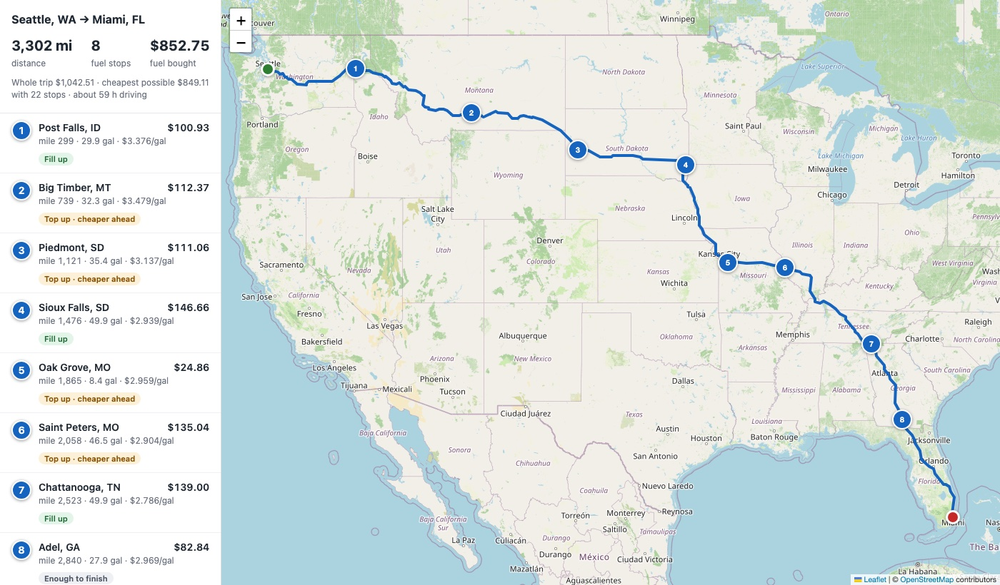
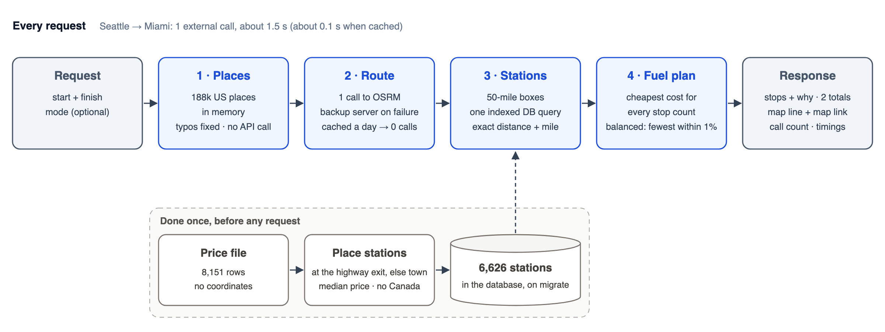

# Fuel Route API

[](https://github.com/Himmu1144/spotter-fuel-route-api/actions/workflows/tests.yml)

A Django API that takes a start and finish in the USA and returns the driving route on a map, cost-effective fuel stops for a vehicle with a 500-mile range, and the total fuel cost at 10 miles per gallon, using the provided fuel price list.



## Highlights

- **One external call per trip, none on a repeat.** Places are resolved locally; only the route comes from OSRM (free, no key), and it's cached. Every response reports its call count.
- **Fast:** about 1.5 to 2 s for a new coast-to-coast trip, nearly all of it the routing call; about 120 ms when the route is cached.
- **Practical, not just cheapest.** By default it picks the fewest stops within 1% of the cheapest plan: Seattle to Miami is 8 stops for $852.75, against 22 stops for $849.11. `mode=cheapest` gives the cheapest.
- **Optimal, and checked.** The optimiser finds the cheapest plan for every number of stops up to 30 (no real trip needs more; the response warns if the limit is ever reached); a test compares it with brute force on 300 random trips.
- **The messy price file, handled.** It has no coordinates, so stations are placed once, offline: 3,389 at the actual highway exit their address names ("I-80, EXIT 439"), the rest at their town. 905 duplicate rows are priced at their median, and Canadian rows are dropped.
- **Forgiving input, strict contract.** `City, ST`, `City, State` or `lat,lon`, checked against the real US border. Typos are corrected and reported ("Chicgo" is read as Chicago), "Chicago" alone works, and "Portland" gets a list of the options instead of a guess.
- **Every number explains itself.** Each stop says why it buys that amount and how its price and location were worked out; errors say exactly what went wrong, including where the price list has no stations.
- **Real Django underneath:** models, an indexed station query, migrations that load the data, 38 tests run in CI on SQLite and Postgres, and Redis caching when configured.

## Quick start

Requires Python 3.12 or newer.

```bash
git clone https://github.com/Himmu1144/spotter-fuel-route-api.git && cd spotter-fuel-route-api
python3 -m venv .venv && source .venv/bin/activate
pip install -r requirements.txt
python manage.py migrate      # creates the tables and loads the 6,626 fuel stations, once
python manage.py runserver
```

Then try <http://127.0.0.1:8000/api/route/?start=Seattle,%20WA&finish=Miami,%20FL>, open the `map_url` it returns, or import `postman/fuel-route-api.postman_collection.json` into Postman: eight requests that walk through everything below, each with checks.

No setup beyond that: SQLite and an in-memory cache by default. `docker compose up -d` starts Postgres and Redis; set `DATABASE_URL` and `REDIS_URL` as in `.env.example` to use them.

## The API

```
GET /api/route/?start=Chicago, IL&finish=Denver, CO[&mode=cheapest]
```

```jsonc
{
  "map_url": "http://127.0.0.1:8000/map/?start=Chicago%2C+IL&finish=Denver%2C+CO&mode=balanced",
  "summary": {
    "distance_miles": 1004.8, "drive_hours": 17.9, "stops": 2,
    "plan": "balanced: the fewest stops within 1% of the cheapest plan. Here that is also the cheapest plan.",
    "fuel_bought_usd": 142.36,      // bought on the way
    "trip_fuel_cost_usd": 320.37,   // all fuel burned, counting the full tank it starts with
    "gallons_bought": 50.6, "gallons_used": 100.48, "stop_limit": 30
  },
  "compared_to_cheapest": { "cheapest_cost_usd": 142.36, "cheapest_stops": 2, "extra_cost_usd": 0.0 },
  "stops": [
    {
      "order": 1, "name": "KUM & GO #0370", "city": "Gretna", "state": "NE",
      "mile": 480.6, "off_route_miles": 0.0, "price_per_gallon": 2.921, "gallons": 6.0, "cost_usd": 17.52,
      "why": "Just enough to reach stop 2, 78 miles on, where fuel is cheaper ($2.799).",
      "price_basis": "the one price listed for this station",
      "location_basis": "the highway exit named in its address (I-80, EXIT 439 & SR-370)"
    }
    // ...
  ],
  "map": { "type": "FeatureCollection", "features": [ /* route line and stops, GeoJSON */ ] },
  "meta": { "external_calls": 1, "route_cached": false, "timing_ms": { "routing": 767.2, "stations": 21.2, "fuel_plan": 21.9 } }
}
```

Errors share one shape, `{"error": {"code": ..., "message": ...}}`: **400** for input it can't read (with what to send instead), **422** when there's no road route or a stretch longer than one tank has no station (with a `gap` saying where), **502** when routing is down.

## How it works



1. **Places:** `start` and `finish` are looked up in a local list of 188,000 US places (from GeoNames), so no geocoding call; coordinates are checked against the US border (US Census Bureau).
2. **Route:** one call to OSRM's public server, with a second public OSRM server tried only if the first fails. Cached for a day by the resolved coordinates.
3. **Stations along the route:** the route is cut into ~50-mile stretches; one indexed database query returns the stations inside a box around any stretch, then each candidate gets its exact distance to the road and its mile along it.
4. **Fuel plan:** dynamic programming over stations, fuel level and number of stops (numpy, about 40 ms coast to coast) gives the cheapest cost for every stop count; the default takes the fewest stops within 1% of the cheapest.
5. **Response:** the route line is simplified from tens of thousands of points to a few thousand, and every stop carries its explanation.

## Decisions and assumptions

- **The vehicle starts with a full tank.** `fuel_bought_usd` is what's bought on the way; `trip_fuel_cost_usd` also prices the starting tank at the first listed station on the route, so a short trip never shows a bare $0.
- **Balanced by default.** The cheapest plan for Seattle to Miami makes 22 stops; every stop costs a driver time, so the default trades up to 1% more fuel cost for far fewer stops. `mode=cheapest` is one parameter away.
- **At most 30 stops.** "Cheapest" means the cheapest plan a driver would follow: up to 30 stops, where real routes need about 20. If the cheapest plan ever uses all 30, the response says so.
- **A one-mile reserve.** Station positions are rounded to the mile, so plans keep a mile in the tank; rounding can never stretch a leg past the 500-mile range.
- **Detours aren't counted.** Mileage is measured along the route. `off_route_miles` is the straight-line distance from a station to the route (usually under a mile for stations at an exit); the actual road detour isn't known and isn't added to fuel use.
- **Duplicate prices:** some stations are listed up to six times with different prices and no dates. Each is priced at the median of its listed prices; the lowest would favour stations listed more often, since each extra row is another chance to look cheap.
- **Station positions:** where the address names a highway exit, the station sits at that exit (OpenStreetMap data, same state, same exit number, nearest the town); it counts as on the route within 3 miles. Otherwise it sits at its town's centre and counts within 10 miles, since that position is approximate.
- **Only US stations:** trips start and finish in the USA, and the file doesn't say what currency its Canadian prices are in.
- **Routing:** OSRM needs no key, so the project runs exactly as shown for anyone. Its public servers route cars; a truck routing profile would be a change to one module.

## Known data gap

The price list has no stations on I-5 between Halsey, Oregon and southern California, and none in central or northern California (its 16 California stations are all in the far south-east). Trips that must refuel there, like San Francisco to Seattle, return a 422 naming the gap rather than inventing a stop.

## In production, I'd change

- **Routing:** a routing engine with a truck profile, such as self-hosted Valhalla or GraphHopper, or a paid service. The public OSRM servers have no uptime promise and route cars, which is why there's a fallback server here.
- **Station search:** PostGIS, with a spatial index and one query for "stations within X miles of this route line". A latitude/longitude index with boxes is fine for 6,600 stations, not for millions.
- **Prices:** ingest the price feed on a schedule, with timestamps, and use each station's latest price instead of the median. Only routes are cached, so new prices take effect immediately.
- **Cache under load:** a lock per trip, so identical requests arriving together make one routing call instead of several.
- **Detours:** route through the chosen stops, so the real road detour to each station is counted in fuel use and range.
- **Vehicle inputs:** current fuel level, tank size and mpg per truck as inputs, instead of the fixed full tank, 500-mile range and 10 mpg from the brief.
- **Gaps in the price list:** let a dispatcher opt in to off-network fill-ups priced at retail where the network has no station, as on I-5 in California.

Deployment itself would be the usual Django setup: `DEBUG` off with a real secret key, gunicorn behind a proxy, rate limiting, and monitoring of routing failures.

## Tests

```bash
python manage.py test    # 38 tests; the routing service is faked, nothing calls the internet
```

They cover the optimiser against brute force, the station search, place lookup and typos, routing fallbacks and caching, the data cleaning, and the API's responses and errors.

## Project layout

```
fuel/
  places.py      place names to coordinates (local list, typo correction)
  routing.py     the OSRM call, its fallback and the route cache
  corridor.py    stations along a route (indexed box query, exact distance, mile marker)
  optimizer.py   where to buy fuel and how much (no Django inside)
  planner.py     one trip end to end, and the response
  views.py       the endpoint: input checks and error codes
scripts/         one-time data builds (below)
data/            the provided price file and the built data, committed
postman/         the Postman collection
```

## Rebuilding the station data

Already done and committed; only needed if the price file changes.

```bash
python scripts/build_places.py      # US place list from GeoNames -> data/us_places.csv.gz
python scripts/build_us_outline.py  # US border from the US Census Bureau -> data/us_outline.json.gz
python scripts/fetch_exits.py       # numbered motorway exits from OpenStreetMap -> data/osm_exits.csv (slow)
python scripts/build_stations.py    # clean the price file and place each station -> data/stations.csv
python manage.py load_stations      # reload it into the database
```

Data: GeoNames (CC BY 4.0), OpenStreetMap (ODbL, © OpenStreetMap contributors) and the US Census Bureau (public domain).
